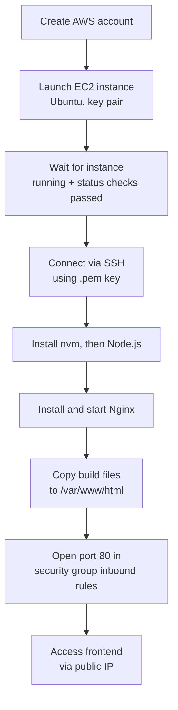

# AWS EC2 Setup and Deployment

## Create an AWS Account

- Go to [aws.amazon.com](https://aws.amazon.com/) and create your account
- It will ask you to fill in some details, and a payment method is required. Adding a payment method does not mean you will be charged: AWS has a free tier, and you can stay within it

## Launch an EC2 Instance

- After signing up, you land on the console page. Search for **EC2** and open the dashboard
- Click **Launch new instance**
  - Give it a name
  - Select the machine image: Ubuntu is preferred
  - Select the instance type
  - Create a new key pair. It downloads a `.pem` file, which is used as the key to log in to and access your machine
- After the instance launches, wait until the instance status is **running** and the status checks have passed
- Click on the instance ID to see details like the private IP, public IP address, and security settings

## Connect to the Instance via SSH

- Click **Connect**. There are multiple ways to connect
- Select the **SSH client** option to log in using a terminal
- Open Git Bash (on Windows) and go to the folder where the `.pem` file is saved
- Change the permissions of the `.pem` file (the exact command is shown on the AWS interface)

```text
chmod 400 "devTinder-secret.pem"
```

- Run the SSH command to connect (also shown on the AWS interface)

```text
ssh -i "devTinder-secret.pem" ubuntu@ec2-16-170-166-93.eu-north-1.compute.amazonaws.com
```

- You are now on the terminal of your instance
- If the instance stays idle, it can disconnect. If that happens, connect again using the same SSH command

## Install Node.js with nvm

- Now that you have access, you can install dependencies from the terminal
- To install Node, you first need nvm

```text
curl -o- https://raw.githubusercontent.com/nvm-sh/nvm/v0.40.7/install.sh | bash
```

- [nvm on GitHub](https://github.com/nvm-sh/nvm)
- After installing nvm, restart the connection:
  - `exit` to terminate the current connection
  - Then connect again using the SSH command
- Install Node by giving the version

```text
nvm install 22
```

- This installs Node version 22.x.x
- It is best to use the same Node version that is working fine on your local machine

## Install and Start Nginx

- Use Nginx to host the frontend on your instance. Nginx acts as the HTTP server

```text
sudo apt install nginx
```

- Start Nginx and enable it to start on boot

```text
sudo systemctl start nginx
sudo systemctl enable nginx
```

## Deploy the Frontend Build

- Nginx creates a folder on your instance at `/var/www/html`. You need to copy your build files there, since that is the folder the HTTP server serves

```text
sudo scp -r dist/* /var/www/html/
```

- Now go to the instance details in AWS and find the public IPv4 address. You can access the frontend from a browser using that IP

## Open the Port (Security Group)

- Visiting the public IP at this point gives a timeout, because AWS blocks all ports by default, and the Nginx HTTP server listens on port 80
- To open the port, go to **Security** in the instance details page and find **Inbound rules**
- Edit the inbound rules and add port 80, with the source set to `0.0.0.0/0` to allow access from anywhere on the internet


