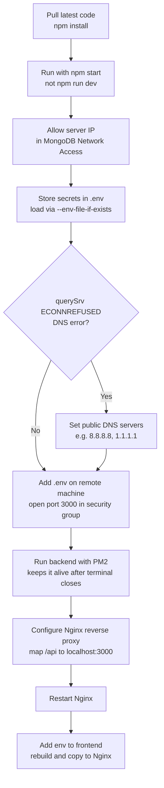

# Backend Deployment: Environment Variables, PM2, and Nginx

## Deploy the Backend to the Server

- To deploy the backend, log in to the remote machine again, pull the latest code, and install the dependencies using `npm install`
- Run the backend on the server using the start command, not `npm run dev`

```bash
npm run start
# or
npm start
```

## Allow Server Access to the Database

- You need to allow the public IP address of your instance to access the database
  - Go to Security, then Network Access, and add the IP address
- But it does not connect, due to this error:

```text
Error connecting to MongoDB MongoServerError: bad auth: Authentication failed, db password missing
```

- So you have two options:
  - Push the password to GitHub and pull it (simple, but anyone can get the password from the git repo)
  - Put the password in the env file

## Securing Secrets with .env

- To keep secrets secure, create a file called `.env` and keep your secrets there by assigning them to variables. You can type a variable name without spaces and assign the secret value to it

```text
MONGO_URI=mongodb+srv://<user>:<pass>@<cluster>.mongodb.net/dev_tinder
```

## Loading Environment Variables in Node

- To use these `.env` values:

```js
process.env.MONGO_URI
```

- All env variables are attached to a big object called `process`
- You might still get an error like `process.env.MONGO_URI is undefined`, even though the variable name matches exactly. This is because Node never reads `.env` on its own. You need to load the env file explicitly
- In the latest Node versions (20+), you can load it by adding a flag to the scripts in `package.json`:

```json
"start": "node --env-file-if-exists=.env src/server.js",
"dev": "node --env-file-if-exists=.env --watch src/server.js",
```

- `--env-file-if-exists` loads `.env` when it's there and skips it quietly when it isn't

## Ignore the .env File in Git

- Do not push the `.env` file to GitHub. Add it to `.gitignore`

## Fixing a DNS Resolution Error with MongoDB

- You might face an issue like this:

```text
Error connecting to MongoDB Error: querySrv ECONNREFUSED _mongodb._tcp.learningnode.p0acwhb.mongodb.net
    at QueryReqWrap.onresolve [as oncomplete] (node:internal/dns/promises:294:17) {
  errno: undefined,
  code: 'ECONNREFUSED',
  syscall: 'querySrv',
  hostname: '_mongodb._tcp.learningnode.p0acwhb.mongodb.net'
}
```

- This happens because, by default, Node asks whatever DNS server your laptop is set to use. On a home network, that is your router, and some routers handle this kind of SRV query badly and refuse the response
- To solve this, set a public DNS server such as `8.8.8.8` or `1.1.1.1`. Node will then ask these servers and resolve the connection string to the correct IPs

```js
if (process.env.DNS_SERVERS) {
  require("dns").setServers(process.env.DNS_SERVERS.split(","));
}
```

## Adding the .env File on the Remote Machine

- You also need to add the `.env` file on the remote machine. To create it:

```bash
sudo nano .env
```

- Write all the required variables
- Now add port 3000 in the security group. Allow it from `0.0.0.0/0` with type Custom TCP

## Keep the Backend Running Forever with PM2

- But if you close the terminal, the application stops. It should not work this way
- The backend should keep running on the server forever. For that, you can use a package called PM2

```bash
npm install pm2 -g
```

- Now run `npm start` via the Process Manager (PM2):

```bash
pm2 start npm -- start
```

- To check the logs (useful for debugging if an error occurs):

```bash
pm2 logs
```

- To remove the logs:

```bash
pm2 flush <process name>
```

- To stop the process:

```bash
pm2 stop <process name>
```

- To delete the process:

```bash
pm2 delete <process name>
```

- To give the process a custom name:

```bash
pm2 start npm --name "dev-tinder-backend" -- start
```

## Connecting Frontend and Backend with Nginx

- Now both the frontend and backend are running on the server. We need to merge them
- Generally, you want to call the backend at a path like `<ip>/api`, but right now your backend URL is `<ip>:3000`. You need to point port 3000 to the `/api` path using an Nginx proxy pass
- Basically, whenever you call any URL on the server, it goes through Nginx. Nginx sits in front of every request and directs it, so Nginx is acting as a reverse proxy here
- Now you need to tell Nginx that whenever a request comes for port 3000, it should map it to `/api`
- For that, you need to change the Nginx configuration. The config file is located at `/etc/nginx/sites-available/default`:

```bash
sudo nano /etc/nginx/sites-available/default
```

- Open the config file and change it as below:

```nginx
server_name your_ip;

location /api/ {
    proxy_pass http://localhost:3000/api/;
    proxy_http_version 1.1;
    proxy_set_header Host $host;
    proxy_set_header X-Real-IP $remote_addr;
    proxy_set_header X-Forwarded-For $proxy_add_x_forwarded_for;
    proxy_set_header X-Forwarded-Proto $scheme;
}
```

- After saving the file, restart Nginx:

```bash
sudo systemctl restart nginx
```

## Updating the Frontend

- Finally, you need to add the env file to the frontend folder too, rebuild the frontend, and copy the build files to Nginx


